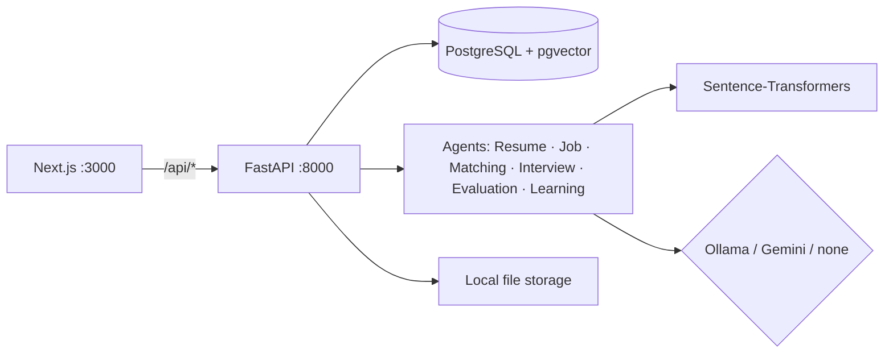

# AgentHire – Explainable AI Recruitment Platform

AgentHire helps recruiters screen resumes, rank candidates and run technical interviews – and it shows
**why** every score was given. Candidates get a skill-gap view, practice interviews and learning links.

> Final-year project. Runs fully on a Windows laptop with free, local tools. No Docker, no paid APIs required.

## The problem
Manual screening is slow and keyword filters miss good candidates (e.g. "Postgres" vs "PostgreSQL").
Many AI tools give a single number with no explanation. AgentHire combines semantic search with clear
rules, keeps evidence for every skill, and leaves all hiring decisions to a person.

## Features
**Must Have – all built**
- Recruiter and candidate accounts (Argon2 passwords, HTTP-only JWT cookie, role checks in the backend)
- Jobs: create/edit/publish/close, automatic requirement extraction from the description (editable)
- Resume upload (PDF/DOCX, single and bulk ≤ 50), validation by file signature, duplicate detection
- Resume parsing to a structured profile with evidence for each skill; manual corrections are kept
- Hybrid match score: semantic similarity + required/preferred skills + experience + education + certifications, with a full breakdown, matched/related/missing skills and retrieved resume evidence (RAG)
- Recruiter-editable weights; keyword baseline stored for comparison
- Candidate explorer (search, filters, sort), side-by-side compare (2–4), hiring pipeline with history
- Interviews: question generation (local LLM or built-in question bank of 270+ questions), editable questions, one-at-a-time answering, autosave, time limits, follow-ups
- Rule-based interview answer evaluation using concept coverage, keyword and synonym matching, with scores, strengths, weaknesses and missing concepts
- Reports (screen + PDF) with recruiter comments; recruiter dashboard
- AI audit log of every LLM call
- Works with no LLM using a built-in question bank and rule-based answer evaluation

**Nice to Have – built:** skill analytics page, candidate skill graph, learning recommendations with progress,
practice interviews, matching evaluation script with real metrics, model comparison.
**Not built:** OCR for scanned PDFs, email notifications, video/voice interviews.

## Tech stack
| Part | Tools |
|---|---|
| Frontend | Next.js 16 (App Router), React 19, TypeScript, Tailwind CSS 4, shadcn/ui, TanStack Query, react-hook-form + zod, Recharts, React Flow |
| Backend | Python 3.11, FastAPI, SQLAlchemy 2, Alembic, Pydantic 2 |
| Database | PostgreSQL 16 + pgvector (or a pure-Python vector fallback) |
| AI | Sentence-Transformers `all-MiniLM-L6-v2`, spaCy `en_core_web_sm`, curated skill taxonomy, Ollama (`qwen2.5:7b`) or Gemini (optional) |
| Testing | Pytest, Playwright |

## Architecture

Details: [docs/architecture.md](docs/architecture.md) · AI details: [docs/ai_methodology.md](docs/ai_methodology.md)

## Database
19 tables (users, candidate profiles, resumes, resume chunks, skills, jobs, applications, stage history,
matches, interviews, questions, answers, reports, notes, AI audit, audit, settings, learning progress).
See [docs/database_schema.md](docs/database_schema.md).

## Folder structure
```
AgentHire/
├── backend/           FastAPI app (app/api, services, models, ai), migrations, tests
├── frontend/          Next.js app (src/app, components, lib), Playwright tests
├── scripts/           seed_demo_data, generate_synthetic_data, evaluate_matching, check_learning_links
├── sample_data/       30 synthetic resumes, 10 jobs, relevance labels
└── docs/              architecture, API, AI methodology, schema, setup, testing, evaluation
```

## Setup (Windows, PowerShell)
Full guide with pgvector install and troubleshooting: [docs/setup_windows.md](docs/setup_windows.md).

**Needs:** Python 3.11, Node.js LTS, PostgreSQL 16/17, (optional) pgvector, (optional) Ollama.

```powershell
# 1. Databases
psql -U postgres -c "CREATE DATABASE agenthire;"
psql -U postgres -c "CREATE DATABASE agenthire_test;"

# 2. Backend
cd backend
py -3.11 -m venv venv
.\venv\Scripts\Activate.ps1
pip install -r requirements.txt
python -m spacy download en_core_web_sm
Copy-Item .env.example .env      # then edit: DB password, SECRET_KEY, LLM_PROVIDER
alembic upgrade head
python ..\scripts\seed_demo_data.py
uvicorn app.main:app --reload --host 127.0.0.1 --port 8000

# 3. Frontend (new terminal)
cd frontend
npm install
Copy-Item .env.example .env.local
npm run dev
```
Open **http://localhost:3000** · API docs **http://127.0.0.1:8000/docs**

No pgvector? Set `VECTOR_BACKEND=python` in `backend\.env` before `alembic upgrade head`.

### Demo accounts (after seeding)
| Role | Email | Password |
|---|---|---|
| Recruiter | demo.recruiter@example.com | DemoPass123 |
| Candidate | aarav.raman@example.com | DemoPass123 |

All seeded people are synthetic and marked "Synthetic" in the UI.

## Environment variables (`backend/.env`)
| Name | Meaning |
|---|---|
| `DATABASE_URL`, `TEST_DATABASE_URL` | PostgreSQL connections (must be different) |
| `SECRET_KEY` | JWT signing secret – long random string |
| `VECTOR_BACKEND` | `pgvector` or `python` |
| `LLM_PROVIDER` | `ollama`, `gemini` or `none` |
| `OLLAMA_BASE_URL`, `OLLAMA_MODEL` | default `http://localhost:11434`, `qwen2.5:7b` |
| `GEMINI_API_KEY`, `GEMINI_MODEL` | only for Gemini; stays on the backend |
| `UPLOAD_DIR`, `MAX_UPLOAD_SIZE_MB` | file storage, default 10 MB |
| `RATE_LIMIT_ENABLED` | turn off only for E2E tests |

Frontend (`frontend/.env.local`): `BACKEND_URL=http://127.0.0.1:8000`.

## AI modes

| Mode | Questions | Answer evaluation |
|---|---|---|
| `ollama` | Locally generated questions using an LLM | LLM-based rubric evaluation |
| `gemini` | Cloud-generated questions using Gemini | LLM-based rubric evaluation |
| `none` | Built-in question bank | Rule-based concept coverage and scoring |

**Current project configuration:** `LLM_PROVIDER=none`.

In this configuration, AgentHire uses its built-in question bank and rule-based interview evaluation. It does not use an external LLM to evaluate answers.

Resume parsing and candidate matching work independently of the interview LLM.


## Tests

Backend tests use Pytest. Frontend end-to-end tests use Playwright.

```powershell
# Backend tests
cd backend
python -m pytest

# Frontend build and end-to-end tests
cd ..\frontend
npm run build
npm run test:e2e
```

The backend must be running with `RATE_LIMIT_ENABLED=false` for the end-to-end tests.

See [docs/testing.md](docs/testing.md) for testing details.

## Matching quality (synthetic labelled set, K = 5)
| Ranker | P@5 | NDCG@5 |
|---|---:|---:|
| Keyword baseline | 0.720 | 0.757 |
| Semantic only | 0.760 | 0.846 |
| **Hybrid (AgentHire)** | **0.900** | **0.930** |

The data is synthetic, so these numbers show the method works as designed, not real-world accuracy.
See [docs/matching_evaluation.md](docs/matching_evaluation.md).

## Security
Argon2 hashing · HTTP-only SameSite cookie · backend ownership checks (other users' records return 404) ·
rate limits on login and AI endpoints · file type checked by signature, size limit, random stored names ·
API keys only on the backend · prompt-injection guard (resume/answer text treated as data) ·
AI text shown as plain text · `.env` never committed.

## Limitations (honest)
- **Ollama and Gemini were not run on the build machine** (no model available). LLM paths are tested with a fake provider. Please test one interview with Ollama locally.
- Resume parsing is rule-based; unusual layouts (multi-column, tables of dates) can lose fields – they can be corrected by hand.
- No OCR: scanned PDFs are rejected with a message.
- Skill taxonomy has 150 skills; others are not recognised.
- Matching evaluation metrics are based on synthetic labelled data and do not establish real-world hiring accuracy.
- Background tasks run in the API process (no queue); fine for a laptop demo.
- Rule-based interview evaluation relies on expected concepts, keywords and synonyms. It may not fully understand the meaning or context of an answer, so recruiters should review candidate responses before making hiring decisions.

## Future work
OCR, larger taxonomy, a task queue (Celery/RQ), email notifications, real anonymised evaluation data,
bias audits on real data, calendar integration.

## Screenshots
_Add screenshots here: landing, recruiter dashboard, match explanation, interview, report PDF._

## License
MIT – see [LICENSE](LICENSE).
