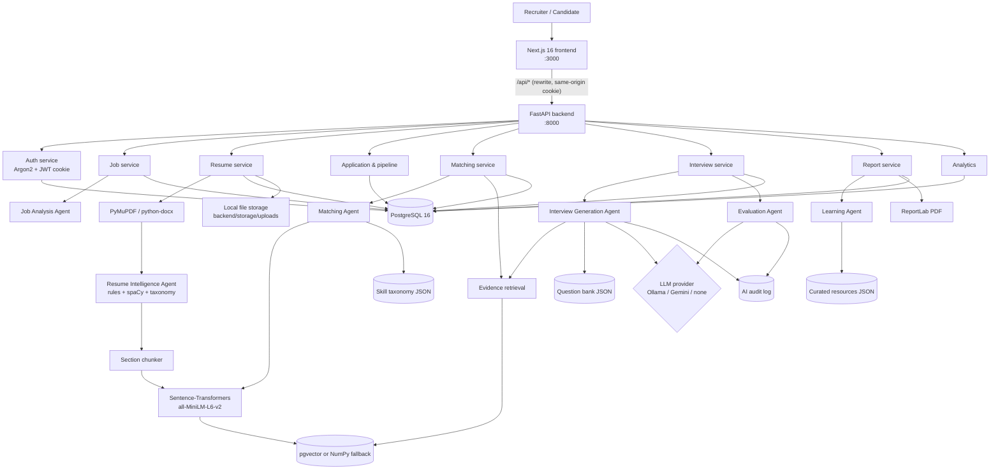

# Architecture

## Layers
- **Frontend** (`frontend/src`): App Router pages, client components with TanStack Query. All API calls go to `/api/v1/*` on the frontend origin and are forwarded to FastAPI by `next.config.ts`, so the HTTP-only cookie stays same-origin. `src/proxy.ts` does an optimistic "is there a cookie" redirect; real checks are on the backend.
- **Backend** (`backend/app`): `api/v1` routers → `services` (business logic, ownership checks in `services/permissions.py`) → SQLAlchemy models. Long work (resume parsing, interview evaluation) runs in FastAPI `BackgroundTasks` with its own DB session.
- **AI** (`backend/app/ai`): `agents/`, `providers/`, `embeddings/`, `rag/`, `parsing/`, `data/`. See `ai_methodology.md`.
- **Storage**: uploads are saved with random UUID names under `UPLOAD_DIR` (outside any public folder); generated PDFs under `storage/reports/`.

## Access rules (enforced in the backend)
| Who | Can see |
|---|---|
| Recruiter | Own jobs; candidates who applied to / were uploaded for those jobs; their interviews, matches, reports, AI audit |
| Candidate | Published jobs; own profile, resumes, applications, own matches (skill-gap view), own interviews and feedback |

Records of other users return **404** (not 403) so ids are not revealed. Role-only violations return 403.

## Key flows
1. **Upload** → file stored, placeholder profile + application created → background parse → profile filled, skills with evidence, chunks embedded → if the parsed email belongs to an existing profile, the two are merged.
2. **Matching** → job embedding cached on the job → candidate profile text embedded → Matching Agent → result + explanation + RAG evidence stored per application.
3. **Interview** → create (draft) → generate (LLM or bank) → ready → candidate starts → one question at a time, drafts autosaved, optional follow-up → complete → background evaluation (LLM or pending) → report.
