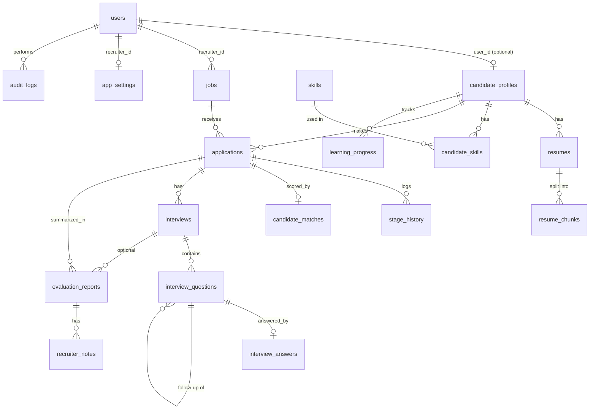

# Database Schema

PostgreSQL 16+, managed with SQLAlchemy models (`backend/app/models/`) and Alembic (`backend/migrations/`).
All primary keys are UUIDs. Status-like columns are strings with CHECK constraints (allowed values in `app/models/enums.py`).

Embedding columns (`resume_chunks.embedding`, `jobs.embedding`) are `vector(384)` when `VECTOR_BACKEND=pgvector`,
or `double precision[]` when `VECTOR_BACKEND=python` (cosine similarity is then computed in Python).

## ER diagram

## Tables

| # | Table | Purpose | Key constraints |
|---|---|---|---|
| 1 | users | Accounts (recruiter / candidate) | email unique; role CHECK |
| 2 | candidate_profiles | Structured profile; may exist without an account (recruiter import) | user_id unique, nullable; email indexed |
| 3 | resumes | Uploaded file + extracted text + parse status | file_hash unique (duplicate detection); status CHECK |
| 4 | resume_chunks | Section chunks + embeddings for evidence retrieval (RAG) | FK resume, cascade delete |
| 5 | skills | Normalized skills from the taxonomy | normalized_name unique |
| 6 | candidate_skills | Candidate ↔ skill with evidence text and section | unique (candidate, skill); verification CHECK |
| 7 | jobs | Job + structured requirements + embedding | status CHECK; recruiter indexed |
| 8 | applications | Candidate ↔ job, current pipeline stage | unique (candidate, job); stage + source CHECK |
| 9 | stage_history | Every stage change, who and when | FK application |
| 10 | candidate_matches | Score components, weights used, explanation | one per application |
| 11 | interviews | Interview config and status | type + status CHECK |
| 12 | interview_questions | Questions with rubric, source and grounding | source CHECK; self-FK for follow-ups |
| 13 | interview_answers | Draft/final answer, dimension scores, verdict, feedback | one per question; eval status CHECK |
| 14 | evaluation_reports | Report JSON + PDF path + methodology version | FK application |
| 15 | recruiter_notes | Human comments, kept apart from AI text | FK report |
| 16 | ai_audit_logs | Provider, model, prompt/rubric version, inputs, timing, validation | |
| 17 | audit_logs | User actions (column `meta`, not `metadata`) | |
| 18 | app_settings | Per-recruiter matching and rubric weights | recruiter unique |
| 19 | learning_progress | Completed learning resources (Nice to Have) | unique (candidate, resource) |

## Delete behaviour
- Deleting a candidate profile deletes its resumes, chunks, skills, applications, matches, interviews and reports (cascade).
- Deleting a user keeps records they created but sets `created_by` / `changed_by` style columns to NULL.

## Migrations
| Revision | Change |
|---|---|
| 0001_initial_schema | All 19 tables; embedding columns are `vector(384)` (pgvector) or `double precision[]` (`VECTOR_BACKEND=python`) |
| 0002_answer_timing_columns | `interview_answers.served_at` (when the question was shown, for the time limit) and `evaluated_at` |
